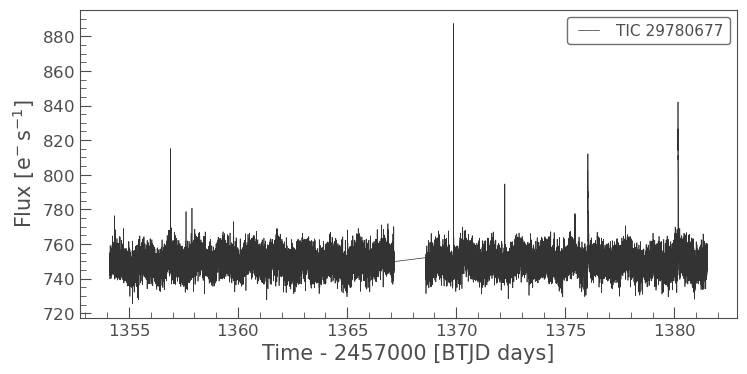
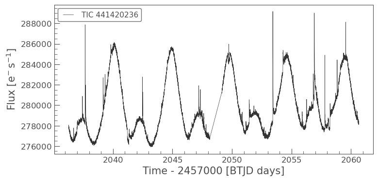
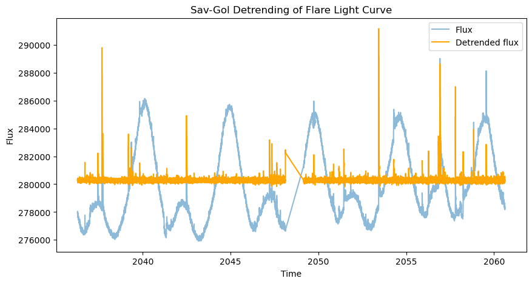

Detrending light curves with AltaiPony
======================================

De-trending [dɪ.tɹˈɛndɪŋ] of lightcurves denotes the removal of
instrumental or some physical trends in order to improve the analysis of
other physical trends, in our case, flares. Flaring stars show
variability on different timescales, with flares typically being a very
fast variation. That allows us to separate it from the *usually* slower
star-spot induced variability, even if the latter has a higher
amplitude.

In this tutorial, we will go through the de-trending pipeline in
AltaiPony, ``custom_detrending``, which is tailored toward removing
spot variability, from weak to heavy, while preserving the flare signal.
In the end, you will also learn how to use your own detrending
function within AltaiPony.

.. code:: ipython3

    import lightkurve as lk
    
    from altaipony.detrending import custom_detrending
    from altaipony.lcio import to_flare_lightcurve
    
    import matplotlib.pyplot as plt

Let’s start grabbing a TESS light curve of TIC 29780677, a young, active
star, observed with TESS with ``search_lightkurve``:

.. code:: ipython3

    # get a table of light curves from MAST
    lc_table = lk.search_lightcurve("TIC 29780677", sector=2, exptime=120, mission="TESS", author="SPOC")
    
    lc_table

.. csv-table:: TESS Observations
   :header: "#", "Mission", "Year", "Author", "Exptime (s)", "Target Name", "Distance (arcsec)"
   :widths: 5, 15, 8, 10, 12, 15, 15
   :class: small-table
   
   0, TESS Sector 02, 2018, SPOC, 120, 29780677, 0.0

Let download the lightcurve:

.. code:: ipython3

    %matplotlib inline
    lc = lc_table[0].download()
    lc.plot();

.. parsed-literal::

    2% (399/18699) of the cadences will be ignored due to the quality mask (quality_bitmask=175).
    2% (399/18699) of the cadences will be ignored due to the quality mask (quality_bitmask=175).

Just like in the Quickstart tutorial, this light curve also shows
flares. Now let’s make ``lc`` a FlareLightCurve object, de-trend it, and
search for flares:

.. code:: ipython3

    def plot_detrending(flcd, offset=200):
        plt.figure(figsize=(10, 5))
        plt.plot(flcd.time.value, flcd.flux, label='Flux', alpha=0.5)
        plt.plot(flcd.time.value, flcd.detrended_flux+offset, label='Detrended flux', color='orange')
        plt.xlabel('Time')
        plt.ylabel('Flux')
        plt.legend()

    flc = to_flare_lightcurve(lc)
    flcd = flc.detrend("custom", func=custom_detrending)
    flares = flcd.find_flares().flares

How the de-trending works
-------------------------

``custom_detrending`` separates the fast flare signal from the slower
rotational modulation in two stages:

1. A polynomial baseline: degree-4 polynomials fitted on overlapping
   windows of 0.6, 0.9 and 1.2 days, blended into one smooth curve.
   Flares are sigma-clipped iteratively, so they do not pull the
   baseline up.
2. A Gaussian process with a rotation kernel (``celerite2``). A
   Lomb-Scargle periodogram of the flux, with the flares from stage 1
   masked, sets the starting period. If the periodogram or the GP
   residual shows a significant second period, the kernel gets a second
   rotation term. A matched filter flags remaining flare candidates in the
   GP residual, and the GP is refitted without them.

The de-trended flux is the residual from the GP model, normalised
by the flux level and centred on 1. If
``celerite2`` is not installed, or ``use_gp=False`` is passed, the
polynomial baseline alone is used.

Heavy spot modulation
---------------------

Spot variability often occurs with large amplitudes and on timescales
close to the light curve length (especially for the shorter TESS light
curves). To see how the pipeline handles this, let’s try a different
light curve:

.. code:: ipython3

    # get a table of light curves from MAST
    lc = lk.search_lightcurve('AU Mic', mission='TESS', author='SPOC', exptime=120, sector=27)[0].download()
    
    lc.plot();

.. parsed-literal::

    0% (31/16812) of the cadences will be ignored due to the quality mask (quality_bitmask=175).
    0% (31/16812) of the cadences will be ignored due to the quality mask (quality_bitmask=175).

.. code:: ipython3

    flc = to_flare_lightcurve(lc)
    flcd_aumic = flc.detrend("custom", func=custom_detrending)
    plot_detrending(flcd_aumic)

Note how the de-trending can still distort large or long-duration flares
(e.g., around t=2053.5d). This does not prevent them from being
detected, but the flare energy estimated will be biased as a result and
smaller flares in their vicinity might be missed. Therefore,
``fit_flares()`` fits a flare around the event’s region, which both
catches additional smaller flares by fitting several flare templates and
finding the best-fit result, and calculates a polynomial baseline around
the already detected event (see Getting Started tutorial).

You own de-trending function
~~~~~~~~~~~~~~~~~~~~~~~~~~~~

Note also the syntax of the de-trending call above. You can pass *any*
detrending function if you use the keyword “custom”. Make sure that the
function returns a ``FlareLightCurve`` object, and that the output is
stored as ``detrended_flux``, ``detrended_flux_err`` keywords to pass
the result to the flare finder.

